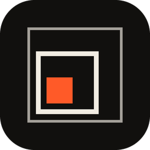
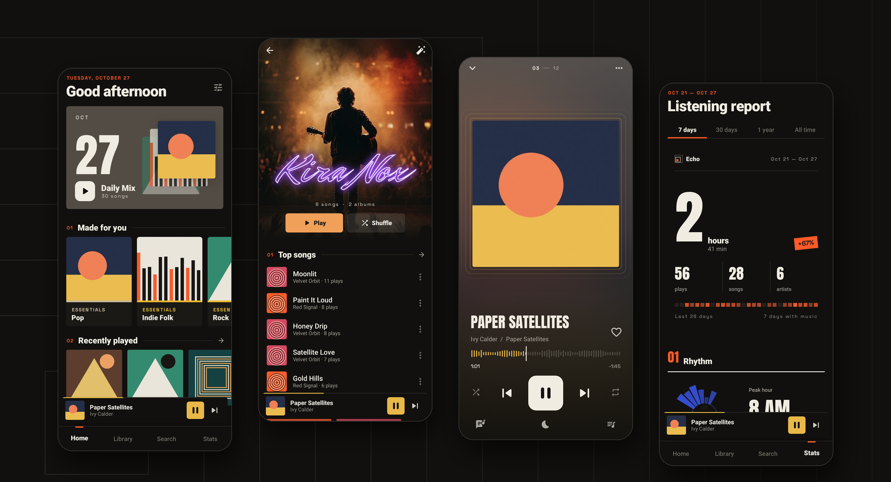
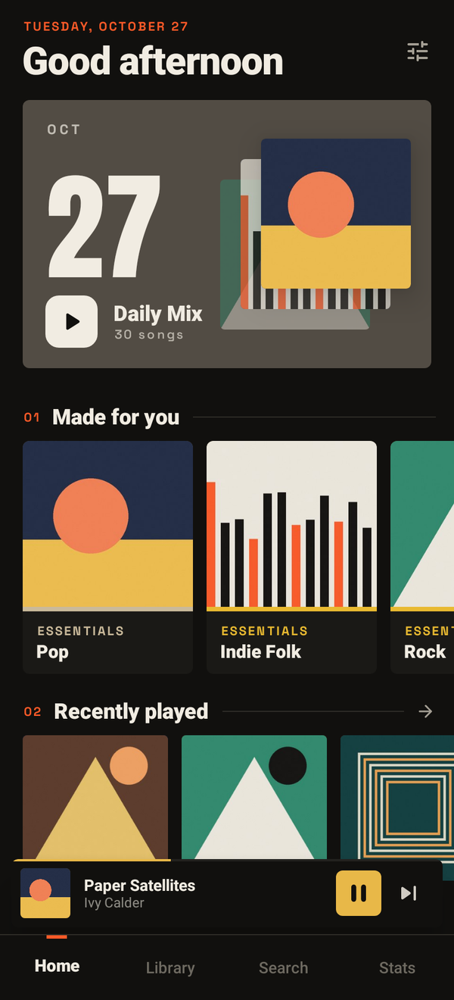
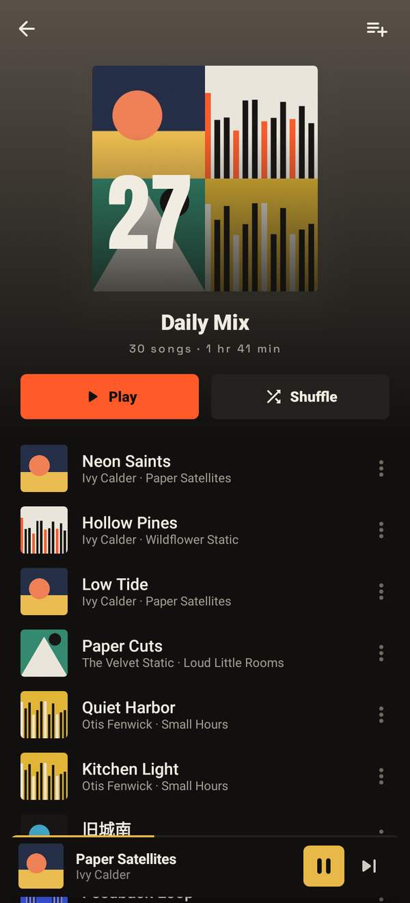
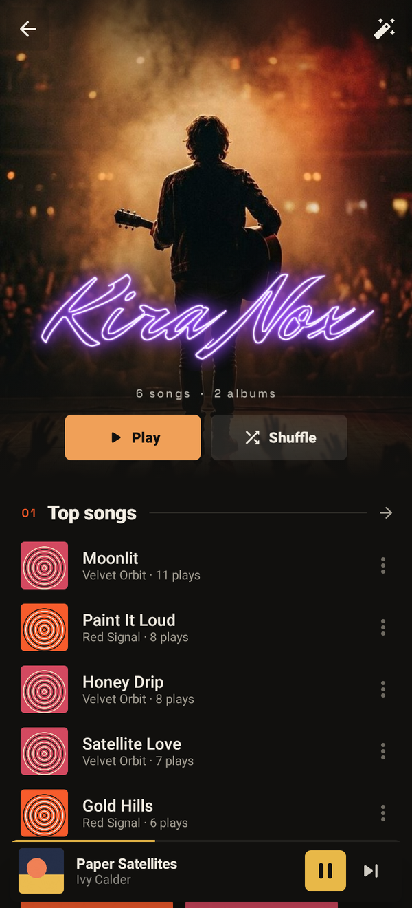
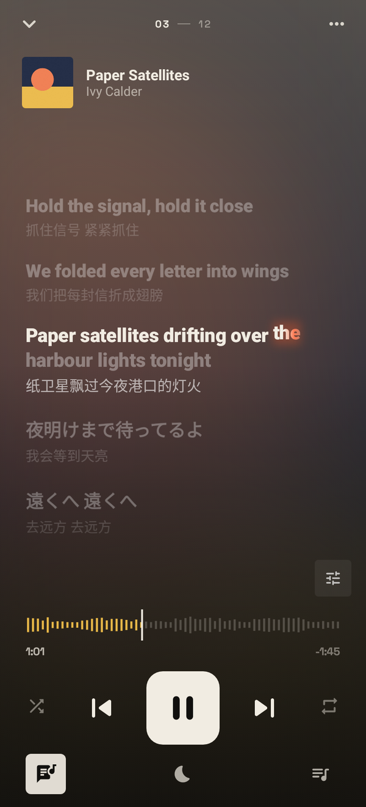
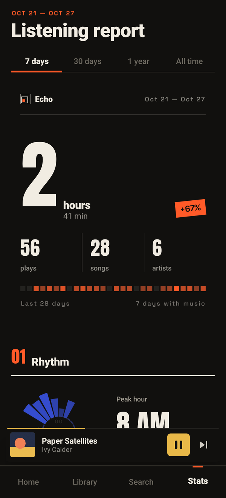
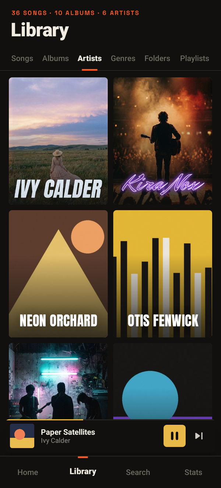

<p align="center">
  
</p>

<h1 align="center">Echo</h1>

<p align="center">
  <b>A local music player that learns from what you actually play.</b><br>
  Daily mixes from your own library. Listening reports. Never online.
</p>

<p align="center">
  <b>English</b> · <a href="README.zh-CN.md">简体中文</a>
</p>

<p align="center">
  <a href="https://github.com/LiDonghao1120/Echo/releases/latest"></a>
  
  
  
</p>

<p align="center">
  
</p>

---

## Why Echo

Echo (回响, "echo") is for people who keep their music as files. It plays what's on your phone and nothing else, and it gets better the more you listen:

- **Local by design.** No account, no streaming, no internet permission. Your files, your playlists and your listening history stay on the device.
- **Personal, not generic.** Recommendations and reports are built from what you play on this phone, not from what everyone else is playing.
- **A look of its own.** The design is built around 回, a square inside a square, like a sound coming back. Ink, paper and vermilion, set in Anton and Space Grotesk.

## Features

### Mixes from your own library
- **Daily Mix**: 30 tracks picked each day from your listening history, weighted towards the artists, genres and albums you keep coming back to. At most three songs per artist and two per album. It stays the same all day and changes the next morning.
- Home also builds **genre Essentials**, **artist Radio**, **Rediscover** (songs you've played at least three times but not in the last 30 days), a **time-of-day mix** (what you usually play at this hour) and **New to You** (songs you've never played).
- Recently played, most played, top artists and recently added, all at a glance.

### Artist pages, your way
- A full-bleed poster with parallax and the artist's wordmark on top. As you scroll, the wordmark shrinks into the top bar.
- Set a **poster** and a transparent PNG **wordmark** for any artist, from the photo picker or from files.
- **Batch import**: choose a folder and Echo matches images to artists by filename. `Artist_Name.png` becomes the wordmark and `Artist_Name_poster.jpg` the poster.
- Artists without a wordmark get their name set in large type.
- Posters and wordmarks also appear on Home, in the artist grid, in search and in your listening report.

### Listening report
- Pick **7 days, 30 days, a year or all time**. See total listening time and how it compares with the previous period, plus plays, songs, artists and a 28-day activity strip.
- Eight chapters: your daily rhythm on a 24-hour dial, the trend over time, your week, top artists, songs on repeat, the album shelf, a genre spectrum, and habits such as streaks and completion rate.
- A play counts after 10 seconds. Reaching 85% or moving on to the next track naturally counts as a full listen.

### Now Playing
- Colours taken from the album art, a large title and a waveform-style scrubber.
- The mini player expands into Now Playing with a shared-element transition.
- In the queue, swipe a track away or move it up next. **Play next** and **Add to queue** are available from any song's menu.
- **Sleep timer**: 15, 30, 45, 60 or 90 minutes, any length you dial in, or the end of the current song. The countdown shows in Now Playing, the volume fades out over the last 30 seconds, and the timer keeps running with the app closed.

### Lyrics
- **Synced LRC lyrics** that scroll with the song. Tap a line to jump to it.
- **Word-by-word lyrics**: the current line fills glyph by glyph with a soft cream-to-vermilion wipe, and the word being sung lifts with a glow. Real word timing is used when the file has it (enhanced LRC `<mm:ss.xx>` tags, the inline `[mm:ss.xx]word` form, QRC/KRC word stamps, Apple Music style `.ttml`); other lines are paced by syllable across the line. Switch between line and word mode in the lyrics view or in Settings.
- Echo looks for a `.ttml` or `.lrc` file next to the song, then in a lyrics folder you choose, then for lyrics embedded in the file (ID3 USLT, FLAC `LYRICS`).
- **Bilingual lyrics**: the translation sits under the original line. Lines with the same timestamp, `/`-separated pairs and "original translation" lines (English, Japanese, Korean, mixed Japanese and English, German…, followed by the Chinese) are all recognised.
- "Title - Artist" credit lines at the top of a file stay as one line instead of being split as a translation.
- **Timing offset per song**: nudge lyrics earlier or later in 0.1-second steps from the lyrics view. The offset is saved for that song.
- **Pick a lyric file** (`.lrc`, `.ttml` or `.txt`) for any song. It is kept with the song, follows it if the file moves, and is included in backups.
- Handles multiple timestamps and offsets, and detects UTF-8 and GB18030 encodings.
- Optionally keeps the screen on while lyrics are showing.

### Your library
- Songs (sort by title, artist, album, date added or duration), albums, artists, genres, folders, playlists and favourites.
- **Pinyin search**: find Chinese titles, artists and albums by full pinyin, initials or a mix with characters (`zhoujielun`, `zjl`, `周jl`), all offline. Common polyphonic characters match either reading.
- An **A–Z index** on the song and artist lists, sorted by pinyin with Latin names alongside. Drag along it to jump between letters.
- Tracks with several artists (`/`, `、`, `;`, `&`, `feat.`) show up under each of them.
- If Android doesn't report genres, Echo reads them from the file tags.
- Reads tags Android leaves out: **APEv2** (Monkey's Audio, and MP3 files tagged that way) and **WMA/ASF** metadata, including cover art.
- Opens straight to your library: the last scan is kept on the device and new or removed files are picked up in the background.
- **Scan folders**: add folders with the system picker, including ones Android's media index skips, and include or exclude any folder on the device. Ignore tracks shorter than a set length. Duplicates are removed.
- Favourites, playlists and listening history follow your files: they are tied to each file's path, and a song that was moved or renamed is found again by its tags.

### Backup and diagnostics
- **Backup**: export favourites, playlists, listening history, settings, scan folder rules, lyric offsets and picked lyric files, and artist posters and wordmarks to one file you save wherever you like. When importing, choose to merge with what's on the phone or replace it.
- **Diagnostic log**: Echo keeps a small log on the device (playback recovery, scan times, errors and crashes) that you can save from Settings and attach to a bug report. It is never sent anywhere.

### Sound
- **Equalizer** with ten presets and a custom curve you drag by hand. Presets are defined on octave bands and fitted to however many bands the phone offers.
- **Bass boost** on phones that support it.
- **ReplayGain**: even out loudness by track or by album from `REPLAYGAIN_*` tags (ID3, Vorbis comments, MP4, Opus R128), with a preamp and clipping prevention. Gapless albums stay gapless.
- **Fades**: a short fade in and out on play, pause and skip, which you can turn off.
- Settings → Audio effects, or from the menu in Now Playing.

### Home screen widget
- Cover, title, artist and previous / play / next, in the same ink, paper and vermilion. Resizes from a single row to a two-row card and follows light and dark mode.
- Keeps showing the last song after the app is closed or the phone restarts; tap play to pick the queue up where it stopped.

### Playback
- Media3 ExoPlayer in a background service, with controls in the notification, on the lock screen and on Bluetooth or wired headsets.
- Pauses when headphones are unplugged and respects audio focus.
- Your queue and position are restored after a restart.
- If a track stalls or fails to decode, Echo restarts it where it stopped, and skips it if it keeps failing.
- Dark, light or follow the system.

### English and Simplified Chinese
- The whole interface is written for both languages, from the listening report to the widget and the notification, with proper plurals and dates (“1 song”, “Tuesday, October 27”).
- Echo follows your phone's language. To choose, go to Settings → Language: Follow system, 简体中文 or English. On Android 13 and later you can also set it in the system's per-app language settings.
- Switching applies right away and doesn't stop the music.

## Screenshots

<p align="center">
  
  
  
</p>
<p align="center">
  
  
  
</p>

<p align="center"><sub>Artists, albums and artwork in the screenshots are fictional samples.</sub></p>

## Download

Get the latest APK from **[Releases](https://github.com/LiDonghao1120/Echo/releases/latest)**.

- Requires Android 8.0 (API 26) or later.
- Every release is signed with the same key, so you can install over an older version and keep your history, playlists and artist art.
- The interface is in English and Simplified Chinese.

## Privacy

Echo has no internet permission, so it cannot send anything anywhere. It reads the audio files on your device and keeps its own data (listening history, playlists, favourites, artist posters and wordmarks) in app storage. Nothing leaves your phone unless you export a backup or a diagnostic log yourself, or Android's own device backup is turned on, in which case the database is included like any other app's.

## Building from source

```bash
git clone https://github.com/LiDonghao1120/Echo.git
cd Echo
./gradlew :app:assembleRelease
```

You need JDK 17+ and the Android SDK (compileSdk 36, minSdk 26). Without a release keystore the build falls back to debug signing. Unit tests run with `./gradlew :app:testDebugUnitTest`, and `./gradlew :app:recordRoborazziDebug` renders the screenshots. Every push to `main` is built by GitHub Actions; pushing a `v*` tag publishes a release.

### Tech stack

Kotlin · Jetpack Compose · Material 3 · Media3 (ExoPlayer, MediaSession) · Room · DataStore · Coil · AndroidX Palette · Robolectric + Roborazzi screenshot tests

Fonts: [Anton](https://github.com/googlefonts/AntonFont) and [Space Grotesk](https://github.com/floriankarsten/space-grotesk), under the SIL Open Font License. Pinyin readings come from [pinyin-data](https://github.com/mozillazg/pinyin-data) (MIT), packed by `tools/gen_pinyin.py`. See [licenses/](licenses).

---

<p align="center"><sub>Made for the music you actually own.</sub></p>
