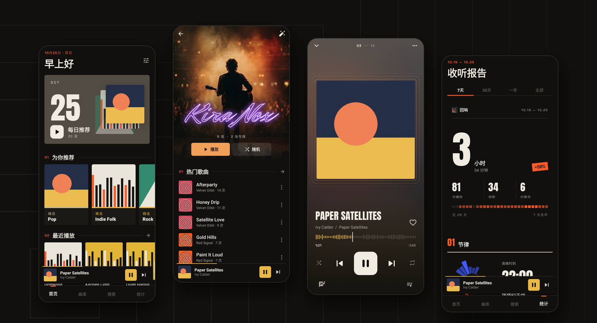
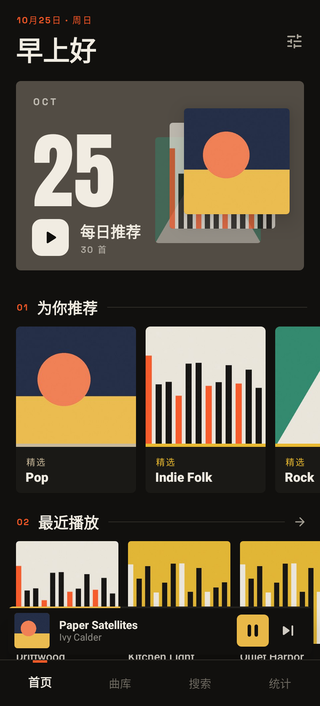
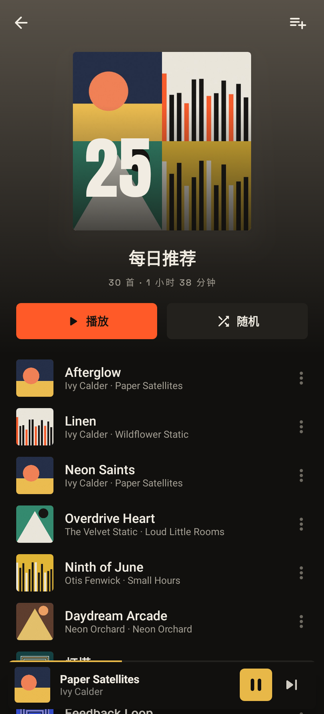
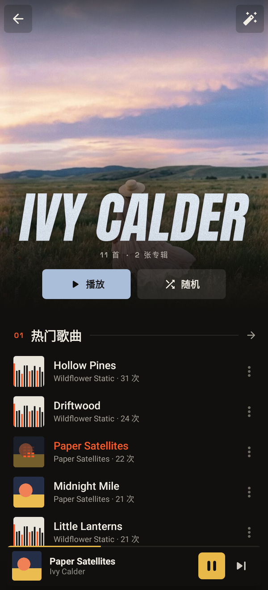
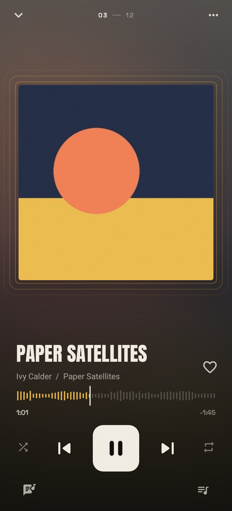
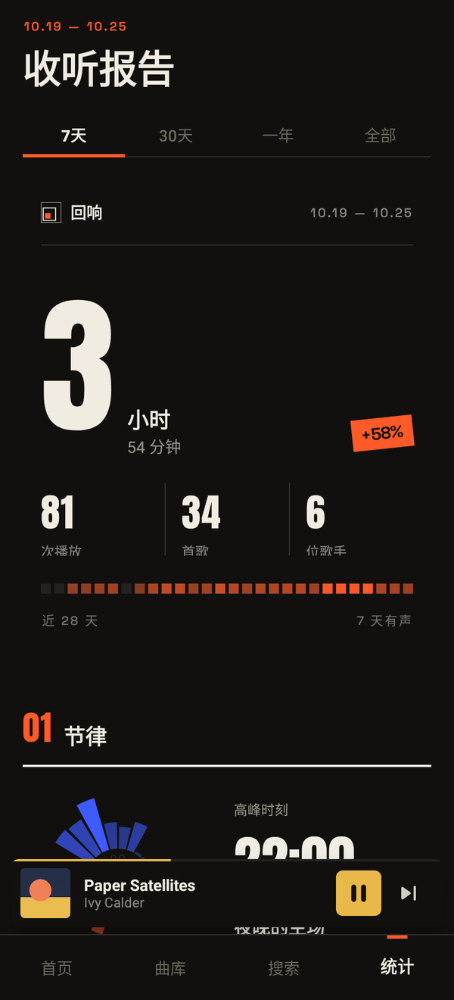
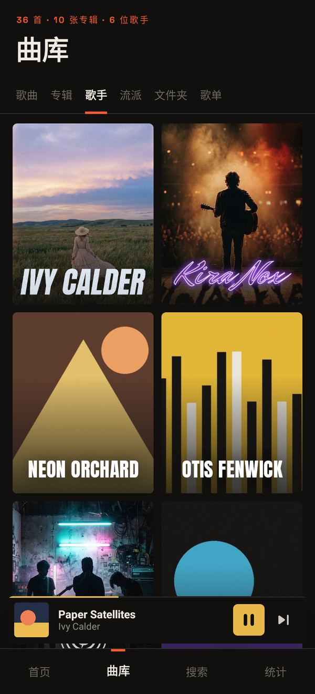

<p align="center">
  
</p>

<h1 align="center">回响</h1>

<p align="center">
  <b>越听越懂你的本地音乐播放器。</b><br>
  每日推荐 · 收听报告 · 永不联网
</p>

<p align="center">
  <a href="README.md">English</a> · <b>简体中文</b>
</p>

<p align="center">
  <a href="https://github.com/LiDonghao1120/Echo/releases/latest"></a>
  
  
  
</p>

<p align="center">
  
</p>

---

## 为什么是「回响」

回响写给习惯把音乐存成文件的人。它只播放手机里的歌，听得越多，越合你的口味：

- **纯本地**：没有账号、没有在线曲库、没有网络权限。音乐文件、歌单和收听记录都留在手机上。
- **只属于你**：推荐和报告都来自你在这台手机上的真实收听，而不是大众榜单。
- **有自己的样子**：设计语言源自汉字「回」—— 方框套着方框，像声音的回响。墨、纸、朱三色，Anton 与 Space Grotesk 字体。

## 功能

### 从你自己的曲库里推荐
- **每日推荐**：每天从你的收听记录里挑 30 首，偏向你常听的歌手、流派和专辑；同一歌手最多 3 首、同一专辑最多 2 首。当天不变，第二天换新。
- 首页还有**流派精选**、**歌手电台**、**重温**（听过至少 3 次、但 30 天没听的歌）、**此刻常听**（你通常在这个时段听的歌）和**新发现**（从没播放过的歌）。
- 最近播放、最常播放、常听歌手、最近添加，一眼看全。

### 自定义歌手页
- 全幅海报带视差，歌手标志居中压在海报上；向上滚动时，标志缩小并停到顶栏。
- 可为每位歌手设置**海报**和透明 PNG **名称标志**，从相册或文件中选择。
- **批量导入**：选一个文件夹，回响按文件名自动匹配歌手：`Artist_Name.png` 作为标志，`Artist_Name_poster.jpg` 作为海报。
- 没有标志的歌手，用大号字体排出名字。
- 海报和标志也会出现在首页、曲库歌手网格、搜索和收听报告里。

### 收听报告
- 可选 **7 天、30 天、一年、全部**：总收听时长及与上一周期的对比，播放次数、歌曲数、歌手数，以及近 28 天的活跃方块条。
- 八个章节：24 小时日晷上的收听节律、起伏趋势、一周分布、最爱歌手、单曲循环、唱片架、流派光谱，以及连续收听天数、完整播放率等习惯数据。
- 播放满 10 秒才计入记录；播放到 85% 或自然切到下一首，算作完整播放。

### 正在播放
- 背景配色取自专辑封面，大号标题，波形刻度式进度条。
- 迷你播放器展开为全屏播放页，封面与标题平滑衔接。
- 播放队列里可以左右滑动移除歌曲，或把歌曲移到下一首；任意歌曲的菜单里都有「下一首播放」和「添加到播放队列」。

### 歌词
- **LRC 滚动歌词**，跟随播放自动居中，点按某一行即可跳转。
- 依次查找：歌曲同目录下的 `.lrc` 文件 → 你指定的歌词文件夹 → 文件内嵌歌词（ID3 USLT、FLAC `LYRICS`）。
- **双语歌词**：译文显示在原文下方。同一时间戳的两行、用 `/` 分隔的写法、「原文 译文」同一行的写法（英文、日文、韩文、日英混排、德文等原文后接中文译文）都能识别。
- 支持多时间戳、offset 和逐字时间标签，自动识别 UTF-8 与 GB18030 编码。
- 可选显示歌词时保持亮屏。

### 曲库
- 歌曲（按标题、歌手、专辑、添加时间或时长排序）、专辑、歌手、流派、文件夹、歌单和我喜欢的音乐，以及搜索。
- 多位歌手合作的歌曲（`/`、`、`、`;`、`&`、`feat.`）会分别归到每位歌手名下。
- 系统没有提供流派信息时，回响会直接读取文件标签。
- 打开即是曲库：上次扫描的结果保存在本机，新增或删除的文件在后台自动同步。
- **扫描文件夹**：通过系统选择器添加文件夹（包括系统媒体库漏掉的目录），也可以勾选或排除设备上的任意文件夹；可忽略短于指定时长的音频；重复的歌曲会自动去除。

### 播放
- 基于 Media3 ExoPlayer 的后台播放服务，支持通知栏、锁屏、蓝牙和线控耳机控制。
- 拔出耳机自动暂停，正确处理音频焦点。
- 重启后恢复上次的播放队列和进度。
- 播放卡住或解码出错时，从停下的位置自动重新开始；同一首反复出错则跳到下一首。
- 深色、浅色或跟随系统。

## 截图

<p align="center">
  
  
  
</p>
<p align="center">
  
  
  
</p>

<p align="center"><sub>截图中的歌手、专辑和封面均为虚构示例。</sub></p>

## 下载

前往 **[Releases](https://github.com/LiDonghao1120/Echo/releases/latest)** 下载最新 APK。

- 需要 Android 8.0（API 26）及以上。
- 所有版本使用同一签名，可直接覆盖安装，收听记录、歌单和歌手形象都会保留。
- 界面语言为简体中文。

## 隐私说明

回响没有网络权限，因此无法向任何地方发送数据。它只读取手机上的音频文件，自己的数据（收听记录、歌单、我喜欢、歌手海报与标志）保存在应用私有目录中。除非你开启了 Android 系统自带的设备备份（届时数据库会像其他应用一样被备份），否则数据不会离开手机。

## 从源码构建

```bash
git clone https://github.com/LiDonghao1120/Echo.git
cd Echo
./gradlew :app:assembleRelease
```

需要 JDK 17+ 与 Android SDK（compileSdk 36，minSdk 26）。没有 release 签名文件时会自动使用 debug 签名。单元测试：`./gradlew :app:testDebugUnitTest`；`./gradlew :app:recordRoborazziDebug` 可生成截图。每次推送到 `main` 都会由 GitHub Actions 构建；推送 `v*` 标签会发布 Release。

### 技术栈

Kotlin · Jetpack Compose · Material 3 · Media3（ExoPlayer、MediaSession）· Room · DataStore · Coil · AndroidX Palette · Robolectric + Roborazzi 截图测试

字体：[Anton](https://github.com/googlefonts/AntonFont) 与 [Space Grotesk](https://github.com/floriankarsten/space-grotesk)，采用 SIL Open Font License（见 [licenses/](licenses)）。

---

<p align="center"><sub>为你真正拥有的音乐而做。</sub></p>
